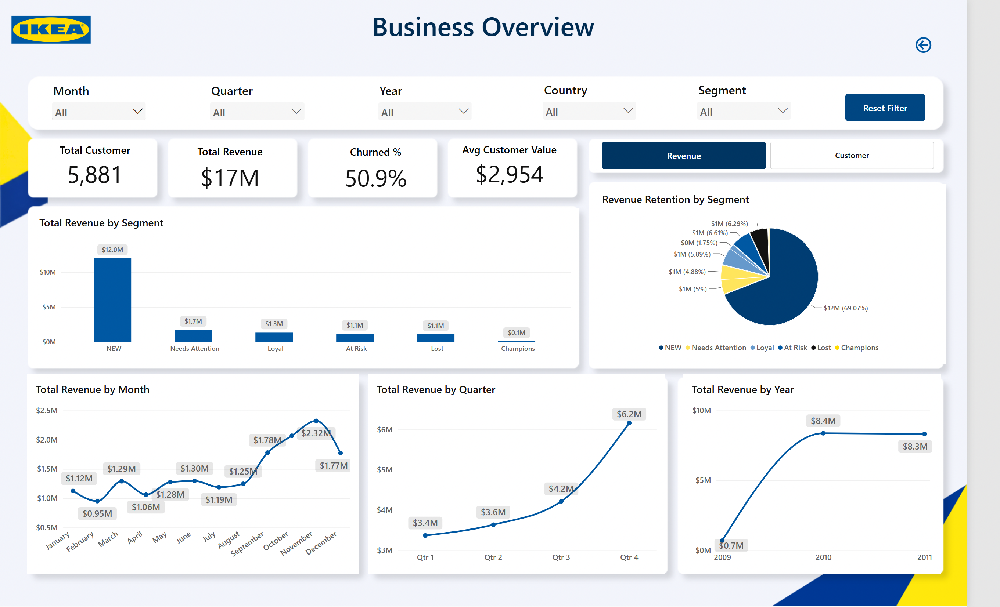

# Customer Analytics & RFM Segmentation

## Objective

Identify the most valuable customer segments and quantify churn risk.So, Marketing, CRM and Retention teams can focus effort where it matters most.

## Business Questions

- Who are the most valuable customers, and how much revenue do they contribute?
- Which customers have gone quiet and risk churning?
- How do customer value and retention trend month over month and year over year?
- How do value and churn risk differ across countries?
- What specific actions should the business take for each segment?

## Methodology

1. **Extraction & cleaning:** Combined two seperate tables, transformed into proper data type,removed duplicates.
2. **RFM calculation** per customer:
   - **Recency:** days since last purchase
   - **Frequency:** number of distinct purchase transactions
   - **Monetary:** total revenue in the analysis period
3. **Scoring & segmentation:** RFM scores mapped to six segments
4. **Churn flag:** no purchase in the trailing **90 days**

## Customer Segments

| Segment | Description |
|---|---|
| Champions | High recency, frequency, and monetary value; the most valuable customers |
| Loyal | Consistent purchase history, moderate to high value |
| At Risk | Previously valuable customers whose recency has dropped |
| New | Recent first-time customers, not yet repeat buyers |
| Needs Attention | Moderate recency but low frequency |
| Lost | No meaningful activity for an extended period |

## Key Findings

- Champions make up **5.36%** of customers but generate **4.88%** of revenue
- **2993** customers (**50.9%**) are flagged as churned under the 90-day rule
- Year **2010** was the highest churned rated which was **56.3%**
- **United Kindom** is the largest market and **EIRE** is the top valued customer

## Recommended Actions

| Segment | Action |
|---|---|
| At Risk | Targeted win back campaigns & personalised offers |
| Needs Attention | Reminders and bundles to lift purchase frequency |
| Lost | Low-cost reactivation attempt and deprioritise spend |

## Tools

Python (Pandas, NumPy), SQL, Power BI
